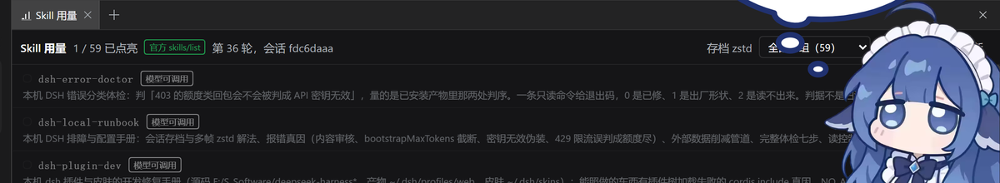

# dsh-skill-meter

 



*真机截图：同一个会话里 `1 / 59 已点亮`，页头右侧标着数据来自 `官方 skills/list` 与「第 36 轮，会话 fdc6daaa」，下面逐条列出 skill（用过地点亮、没用过的压暗），右侧可按「全部 (59)」过滤。*

把「本机有哪些 skill、这个会话真的用过哪几个」做成 **dsh-better-sidebar 的一个侧边栏页面**：右侧栏 `+` 菜单里选「Skill 用量」，页头是 `点亮数 / 总数`，每条 skill 一行 —— 用过地点亮（绿点 + 次数 + 首次/最近第几轮 + 是模型加载还是直接触发），没用过的压暗；底部另列「存档里用到、本机清单里没有」的幽灵名字（改过名或删掉的 skill 一眼看见）。侧边栏本来就按会话隔离，所以这个数就是这个对话的数，不是全局累计。

设置页里的「侧边卡片」分区会自动出现这张卡的开关（`registerTab` 的宿主福利），不用自己造卡片。**曾经的做法是往设置面板里塞一张外来卡片 + 左下角常驻徽标，效果很差，也已经删掉了** —— 宿主早就有侧边栏页面与侧边卡片设置这套扩展点，第三方没有理由再造一个。

## 数据从哪儿来（0.2 起改了口径）

**清单走宿主官方接口，用量才走磁盘。**

早先这一节写着"没有现成接口可用"，那是**错的**：我只搜了 HTTP 路由与 skill provider 注册点，
漏了 typert Remote 那一层。实际上宿主有正式的技能清单接口，本包现在就用它：

- Remote 命名空间 `skills`，方法 `skills/list`，请求 `{ sessionId }`，
  响应 `{ skills: [{ name, description, whenToUse?, modelInvocable }] }`
  （类型在 `@deepseek-ai/dsh-api-session-controller/lib/types/types.d.ts`）。
- 宿主侧实现是 `ctx.sessionSkillCatalog`（`SessionSkillCatalog`），注释写明
  *Session-addressed, cold-readable*、*without activating a cold Agent*、*without loading skill bodies*。
- 客户端拿法是现成先例：宿主自己的 `dsh-client-ui-skill`（就是 `/名字` 那个建议菜单）在
  `inject` 里点名 `'remote'` 与 `'remote.skills'`，然后 `ctx.remote.skills` 直接用。本包照同一种写法。
- 清单变更还有事件可订：`skills/change`（订上了就不用等轮询；订不上也不影响，仍有 20s 刷新）。

**只有"本会话用过哪些"确实没有官方接口**，这条仍然读会话存档：
`{"type":"tool/call","data":{"name":"skill","arguments":"{\"name\":\"...\"}"}}` 是模型加载，
消息 `source.kind === "skill-invocation"`（`SkillInvocationSource{name, form:'instructions'}`）
与存档里的 `<skill_content name="...">` 是用户 `/名字` 直接触发。zstd 用 Node 24 自带的
`zlib.zstdDecompressSync`，**按帧魔数切开逐帧解**（存档是追加式多帧，整体流式解会在第二帧报
`Unknown frame descriptor`），零第三方依赖。

所以页头上那个来源标记不是装饰：显示 `官方 skills/list` 说明清单是宿主算的（改 SKILL.md 不用重启，
`whenToUse` 与 `modelInvocable` 都在）；显示 `磁盘兜底` 说明这次没拿到 Remote（宿主太老或没挂上），
退回读 `~/.agents/skills/*/SKILL.md` 的 frontmatter。两条路都是我们自己跑过的。

## 分组与排序（0.2.3 起：纯视图，不产生根、不产生容器）

页头多了一个下拉框：组的名字、组的先后、组内谁在前，全都来自 `~/.dsh/skill-view.json`。**它只决定「怎么摆」，
不决定「有哪些」** —— 清单永远以宿主 `skills/list` 为准；文件不在、写坏了，都退化成没有下拉框的原样，不会把页面搞坏。

```json
{
  "version": 1,
  "groups": [
    { "name": "运行时", "skills": ["dsh-local-runbook", "dsh-plugin-dev"] },
    { "name": "额度与成本", "skills": ["free-llm-pool"] }
  ]
}
```

- **组按文件里的顺序渲染，组内按数组顺序**（都不是字典序）。没写进任何组的落进页面自带的「（未归组）」，
  所以**不会有 skill 因为没进配置就从页面上消失**。
- 改名＝改 `name`。空组照常显示（建了组就得看得见），`skills` 可以留空数组。
- 服务端**每次请求现读**这个文件：改完存盘 + 刷新页面即生效，**不用重启 `dsh web`**。
- 一键播种（按那份七类分类账生成初始分组，之后两边各归各、不再同步 —— 语义分类是事实、该有闸，
  怎么摆是口味、不该有闸）：`python ~/.agents/skills/skill-center-map/scripts/catalog.py --seed-view`

一条边界，写在这儿省得下次又想去建文件夹：宿主 `skills/list` 只回
`{name, description, whenToUse, modelInvocable}`，**不带任何分类字段**；上游 `discoverRoot()` 也**只扫一层**
（`<root>/<dir>/SKILL.md`），在技能根下建 `runtime/` 这种子文件夹会让那一整类 skill **从目录里静默消失**。
所以分组只能待在视图层 —— 这不是偷懒，是唯一不坏事的位置。

## 装载与生效条件

```bash
dsh plugin --profile web add dsh-skill-meter        # 从 registry 装（发布之后）
dsh plugin --profile web add <仓库根>/plugins/dsh-skill-meter   # 从本地源码开发时装目录
```

装进 web profile 后会落成 `package.json` 的依赖 + `dsh.profile.bundles` + `node_modules` 软链 + lock。**本机开发用的是后一种（`link:` 指向本地目录）**，改源码即时生效；前一种要等发布。

本包是双面板包：`exports["."]` 是 node 侧（注册 `/dsh-skill-meter/data.json` 路由），`exports["./client"]` 是浏览器侧（宿主客户端模块图里的 `window.__ModuleLoader__.load` bundle，`require('react')` 拿宿主的 react，`inject: ['betterSidebar', 'remote', 'remote.skills']` 后调 `registerTab`）。**服务端那半个文件改了要重启 `dsh web`**（重启会打断当前会话，由人自己点）；**浏览器侧 `lib/client.js` 只要刷新页面（Ctrl+R）**，不碰服务端也不用重启 —— 这一条是这次改动能当场验完的原因。

装好之后先验服务端。这条路由注册在 `ctx.webServer` 上（裸路由，不走宿主的浏览器鉴权），
所以本包自己判来源：**Host 必须是 loopback、`sec-fetch-site` 不是 `cross-site`、有 `Origin` 时主机名要与 Host 一致**，
不满足就 403；响应也不带 `Access-Control-Allow-Origin`。本机 shell 里的 `curl` 不受影响：

```bash
curl -s "http://127.0.0.1:3080/dsh-skill-meter/data.json" | head -c 200   # ok:true + skills[] + lit/total/skillsRoot
```

再开 GUI：右侧栏 `+` 菜单里该有「Skill 用量」，设置页「侧边卡片」里该有它的开关。
没出现就按顺序查：`dsh plugin --profile web list` 有没有本包 → `package.json` 的 `dsh.bundle.patch` 与 `dsh.client.platform` 在不在 → 浏览器控制台里有没有 `cannot get module`/`betterSidebar` 相关报错（侧边栏没装时本包只会 warn 一句，不挂页面）。

卸载：`dsh plugin --profile web remove dsh-skill-meter`。

## 不启动 dsh 的自检

```bash
node test/selftest.mjs      # 数据层：清单解析、多帧 zstd 逐帧解、点亮与幽灵
node test/routes.mjs        # 服务端：假 ctx 跑 data.json，同源放行 / 跨站与 DNS 重绑定 403 / 不带跨域头
node test/client-smoke.mjs  # 浏览器侧：假 react + 假 betterSidebar 跑 bundle 求值、
                            # 注册描述符完整性、两遍渲染后的全部读数与角标
```

## 装与不装

```bash
# 装（会走 pnpm 写 `~/.dsh/profiles/web`，跑之前最好先停掉 dsh web）
dsh plugin --profile web add dsh-skill-meter                       # 从 registry 装
dsh plugin --profile web add <仓库根>/plugins/dsh-skill-meter       # 从本地源码装（开发用）
# 之后重启 dsh web —— 只有插件树需要重启，改 lib/client.js 只要刷新页面
# 卸载
dsh plugin --profile web remove dsh-skill-meter
```

`lib/client.js` 由路由每次请求现读磁盘，所以调样式与布局只要刷新页面（Ctrl+R）；改 `lib/index.js`（服务端）才要重启。没装之前它什么都不会发生，也不会报错——徽标是注入到 index.html 才出现的。

## 发布状态

- 没发 npm，仓库 `mengge237/dsh-skill-meter` 保持私有。它现在的定位是本机自用加素材：等哪天把它当上游 PR（给 dsh 官方或 better-sidebar 生态）提出去，再转公开；PR 没提上去之前不公开。
- 因此下面这些不外传：README 与代码里不写本机凭据路径、不写自签会话 cookie 那套应急手法（那条只记在本机 skill 里）。

## 边界

- 全程只读：读 `~/.agents/skills`、`~/.dsh/sessions`，不写任何 dsh 数据，缓存只在内存里（存档 mtime+size 没变就不重复解压）。
- 取"最近的存档"当当前会话；多开会话时可用 `/dsh-skill-meter/data.json?session=<id>` 指定。
- **会话 id 就是带 `session-` 前缀的整条**（宿主 mint 的是 `session-<uuid>`，侧边栏 `props.scope.sessionId` 给的就是这条，会话目录名也是这条整 id —— 宿主用 `encodeSegment(id)` 当目录名）。所以取存档按整条 id 精确比，只给 uuid 那一半也能命中；点了名却找不到就明确回"没找到"，绝不回落到别的会话顶上。2026-09-10 之前这里写成 `p.includes('session-' + sessionId)`，前缀加了两遍，真页面每条请求都落进"没找到"分支，而那条分支还引用了一个不存在的 `query`，于是在宿主那里变成空 body 的 HTTP 400 —— 页面上只剩「用量取数失败：HTTP 400」，把真因和排查方向一起带偏。
- 设置对话框没打开时不往里面插卡片（只留小徽标）；插的位置是 dialog 内右下角浮动，不隐藏、不改官方设置内容区的 DOM。
- 与深海女仆皮肤的 hooks 同时改设置弹窗：本插件用 MutationObserver（400ms 节流）在节点被换掉时补回来。
- `点亮但不在 catalog 快照里` 会单独提示，用来发现"磁盘上有但这次会话没发给模型"的 skill；反过来用过但清单里查不到（被删的 skill）会进 `ghost` 列表。
- 输出与界面文案一律不用 emoji。

## 文件

| 文件 | 作用 |
|---|---|
| `lib/index.js` | 服务端：扫清单、解存档、注册 `/dsh-skill-meter/data.json` 与 `/meter.js`、往 index.html 注入 script |
| `lib/client.js` | 浏览器端：徽标 + 面板 + 设置对话框内那张卡片 |
| `test/selftest.mjs` | 不启动 dsh 直接验数据层（只读） |
| `cordis.patch.yml` | bundle 挂载声明，与 whale 挂件同形 |

## 更多

- 数据从哪来（两个读口、0.2 起的口径变更）、设置面（0.2.3 起）、数据层自检与 2026-09-07 的本机实测读数 → [docs/internals.md](docs/internals.md)
- 版本变化 → [CHANGELOG.md](CHANGELOG.md)
